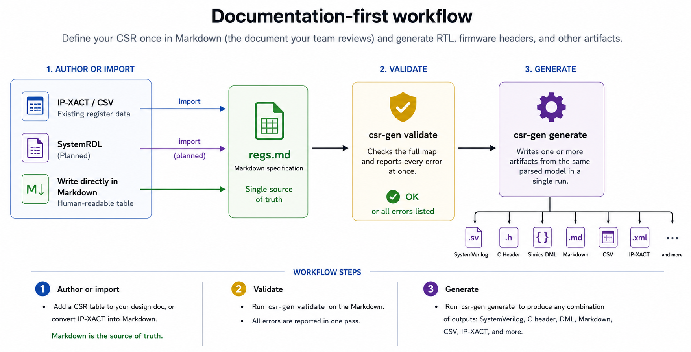
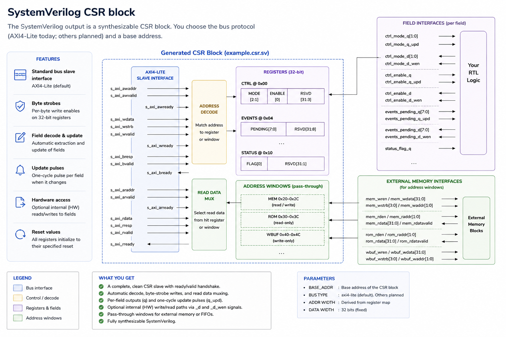

# csr-gen

**Define your CSR once in Markdown—the same document your team reviews as the
register specification—and generate RTL, firmware headers, and other artifacts
from it.**

Most projects maintain separate register spreadsheets, IP-XACT, SystemRDL, RTL,
and header files that drift apart. `csr-gen` converges on a single human-readable
Markdown table as the authoritative register map—whether you write that table
directly or **convert other formats into Markdown** so the documentation becomes
the master copy. You maintain the Markdown specification; the tool validates it
and generates consistent downstream outputs.

## Documentation-first workflow

1. **Author or import** — Add a CSR table to your design doc, or convert an
   existing IP-XACT or SystemRDL description into Markdown.
2. **Validate** — `csr-gen validate` checks the full map and reports every error
   at once.
3. **Generate** — `csr-gen generate` writes one or more artifacts (SystemVerilog,
   C headers, Simics DML, canonical Markdown, CSV, IP-XACT, SystemRDL, and more) from the
   same parsed model in a single run.



**Markdown is the source of truth.** Interchange formats such as IP-XACT and
SystemRDL are inputs that normalize *into* Markdown, not parallel masters.
SystemVerilog, C headers, and other outputs are generated *from* that Markdown
specification (via the shared register model), not maintained as separate
authoritative copies.

`csr-gen` is for system architects (spec owners), RTL designers (CSR block),
firmware engineers (register definitions in C), and Linux driver authors.

## Graphical editor

`csr-gen-gui` is an optional desktop editor (PySide6) for authoring CSR register
maps in Markdown without leaving the graphical view. It uses the same validation
rules and serializers as the CLI, so what you see in preview tabs matches
`csr-gen generate`.


**Main features:**

- **Multiple banks** — One `.md` file can hold several CSR blocks (`##` sections);
  add, rename, and switch banks from a sidebar.
- **Register table** — Edit registers and fields in a spreadsheet-style table with
  expand/collapse per register, drop-downs for `Access` and `HW Access`, context
  menus to add or delete rows, and automatic normalization of names, addresses,
  and reset values.
- **32-bit bitfield canvas** — Visual layout of fields within the selected register;
  drag and resize fields, see unused bit gaps, and reject overlapping fields.
  Table and canvas selection stay in sync.
- **Address map** — Vertical timeline of register blocks (0x0 at the bottom) with
  gaps and address conflicts highlighted; click a block to jump to that register.
- **Validation panel** — Same errors as `csr-gen validate`, reported in one pass;
  previews update from the parsed model when the map is valid.
- **Live previews** — Read-only SystemVerilog (AXI4-Lite by default), C header,
  Simics DML, SystemRDL, and IP-XACT for the active bank, regenerated in-process
  from the current table. SystemVerilog, C, DML, SystemRDL, and IP-XACT previews
  use syntax highlighting (C and DML share a C-like highlighter; IP-XACT uses
  XML highlighting). Use **View → Preview Panes** to show or hide individual
  preview tabs (all are shown by default).
- **Import and export** — **Open** and **Import** replace the whole document
  (Open loads Markdown only; Import loads IP-XACT, SystemRDL, or CSV, with
  selectors when the CLI would require them); **Export Active Bank** writes
  artifacts for the selected bank. Imports and new documents use **Untitled**
  in the window title until you save as Markdown.
- **Save to Markdown** — Writes canonical register tables for managed banks while
  preserving other prose in the file (intro text, notes, non-CSR sections).
- **External memory wizard** — Add ranged external registers (`0x20-0x2F`, one
  `31:0` field, `HW Access` `external`) without hand-editing range syntax.

Install with `pip install ".[gui]"` and run `csr-gen-gui` (optionally pass a
`.md` path on launch). See [Graphical editor (optional)](#graphical-editor-optional)
below for installation details.

## Getting started

You need **Python 3.10+**. Install `csr-gen` into a virtual environment (any
directory where you keep the tool or your project):

```sh
python3 -m venv venv
source venv/bin/activate    # Windows: venv\Scripts\activate
pip install .
csr-gen --version
```

Run `pip install .` from the root of this repository after you clone or unpack
it. That installs the `csr-gen` command and its runtime dependencies only (not
the pytest, formatter, and other packages used to develop the tool itself).

You can instead install the wheel attached to a
[Platform Firmware Resiliency release](https://github.com/altera-fpga/platform-firmware-resiliency/releases):

```sh
pip install csr_gen-1.0.0-py3-none-any.whl
```

For the desktop editor, install that same wheel with the GUI extra:

```sh
pip install 'csr_gen-1.0.0-py3-none-any.whl[gui]'
```

### Try the example specification

If you cloned this repository, you can validate and generate from the bundled
[example-device](specs/golden/example-device/) CSR map:

```sh
mkdir -p work
csr-gen validate \
  --input-file specs/golden/example-device/regs.md \
  --markdown-section "CSR Registers"

csr-gen generate \
  --input-file specs/golden/example-device/regs.md \
  --input-format markdown \
  --markdown-section "CSR Registers" \
  --output-file work/example.sv \
  --output-format systemverilog \
  --output-file work/example.h \
  --output-format c-header \
  --output-file device.dml \
  --output-format dml
```

### Agent skill (optional)

To have an AI agent author csr-gen-compatible Markdown, copy the portable skill
directory [`docs/skills/csr-markdown/`](docs/skills/csr-markdown/) into your
project or agent skills folder (the folder name must stay `csr-markdown`). It
follows the [Agent Skills](https://agentskills.io/specification) layout
(`SKILL.md` plus references and templates). It does not add a Cursor- or
tool-specific skill inside this repository.

When `csr-gen` is on `PATH`, the skill tells the agent to run `csr-gen validate`
on the Markdown it writes. The same GitHub release includes `csr-markdown.zip`.
Unzip it and keep the `csr-markdown` folder name.

For your own design, point `--input-file` at your Markdown, IP-XACT, or SystemRDL source and
write outputs wherever you keep generated artifacts.

Contributors building and testing the tool should follow
[Development](docs/DEVELOPMENT.md) (`make venv`, `make test-unittests`, and related
targets)—not the user install steps above.

### Graphical editor (optional)

Install the desktop CSR Markdown editor separately from the CLI-only wheel:

```sh
pip install ".[gui]"
csr-gen-gui
csr-gen-gui path/to/regs.md
```

From a clone, `make install` builds the wheel into `work/csr-gen/venv/` and
installs wrapper scripts under `work/csr-gen/bin/` (including `csr-gen-gui` by
default). Add that directory to your `PATH`:

```sh
make install
export PATH="$(pwd)/work/csr-gen/bin:$PATH"
csr-gen-gui
csr-gen-gui path/to/regs.md
```

For a CLI-only install without PySide6, run `make install INSTALL_GUI=0` (only
the `csr-gen` wrapper is created).

See [Graphical editor](#graphical-editor) above for the main UI features.

## Key features

### Input formats (`--input-format`)

| Format | CLI value | Notes |
| --- | --- | --- |
| Markdown | `markdown` | CSR table in a named section (`--markdown-section`) |
| CSV | `csv` | Same columns as Markdown; optional `--csr-name` (defaults to file stem) |
| IP-XACT | `ip-xact` | IEEE 1685-2014 and SPIRIT 1685-2009; `--ipxact-address-block` when a map has multiple blocks ([IP-XACT](docs/IPXACT.md)) |
| SystemRDL | `systemrdl` | Flat 32-bit addrmap import/export; nested regfile and addrmap flattening; `--systemrdl-addrmap` for multi-peripheral files ([SystemRDL](docs/SYSTEMRDL.md)) |

Markdown remains the authoritative specification format. CSV, IP-XACT, and SystemRDL normalize
into the shared register model for validation and generation.

### Output formats (`--output-format`)

Pair each `--output-format` with a matching `--output-file`. The input is parsed
once; every requested output is written in order. Aliases: `sv` → `systemverilog`,
`c` → `c-header`.

| Format | CLI value | What you get |
| --- | --- | --- |
| Markdown | `markdown` | Canonical register table (fixed column order; preserves section heading) |
| CSV | `csv` | Canonical register table for spreadsheets and tooling |
| SystemVerilog | `systemverilog`, `sv` | CSR slave module (`--interface-type`, default `axi4-lite`; other buses planned) |
| Firmware C header | `c-header`, `c` | Register offsets, reset values, and field GET/SET macros for bare-metal or firmware use |
| Simics DML | `dml` | Simics 1.4 `device` + `bank` with field access templates |
| IP-XACT | `ip-xact` | Minimal IP-XACT export from the model ([IP-XACT](docs/IPXACT.md)) |
| SystemRDL | `systemrdl` | SystemRDL 2.0 flat addrmap export; native register arrays for address ranges; `csr_gen_access` field UDP ([SystemRDL](docs/SYSTEMRDL.md)) |

Use `csr-gen validate --dump-model` to print the normalized register model as YAML
(inspection only; not a `generate` output format).

Any combination of input and output formats is supported in one
`generate` run—for example IP-XACT or SystemRDL in, Markdown + SystemVerilog + C header + DML out.

### Register specification and validation

- Read and validate Markdown CSR tables from a named section (case-insensitive
  heading match; one table per subsection for register grouping; flexible column
  order; register definition rows separate register metadata from field rows;
  combined rows remain valid; optional `Access`, `Description`, `HW Access`, and
  `Reset` columns with defaults `rw`, the field or register name, `internal`, and
  field reset `0` when `Reset` is omitted).
- Normalize register and field names; enforce 32-bit registers with
  4-byte-aligned addresses.
- Field access types aligned with SystemRDL and IP-XACT (`none`, `ro`, `rc`,
  `rw`, `rw1c`, and others).
- Report every validation error in one pass; allow address gaps and partial
  field coverage within a register.
- `validate` — check a specification without generating output.
- `generate` — parse once and emit every requested `--output-file` / `--output-format` pair.
- Optional desktop Markdown CSR editor (`csr-gen-gui`; `pip install ".[gui]"`).
- GUI undo/redo for register-map edits (Edit menu; Ctrl+Z, Ctrl+Y, Ctrl+Shift+Z).
- Inclusive **address ranges** on `Address` with a **last-byte** end (for example
  `0x20-0x2F` or `0x8000-0x15FFFF`) for external memory-style registers (one
  `31:0` field per range).
- AXI4-Lite `s_axi_awaddr` / `s_axi_araddr` port width follows the CSR map span
  (`register_decoder_addr_width`); `BASE_ADDR` remains 32-bit.
- `--warnings-as-errors` and non-zero exit status on errors.
- Portable **Agent Skill** for authoring csr-gen Markdown maps: copy
  [`docs/skills/csr-markdown/`](docs/skills/csr-markdown/) into another repo or
  skills-compatible tool ([Agent Skills](https://agentskills.io/specification)).

**Current limits:** 32-bit registers with 4-byte-aligned addresses; SystemVerilog
RTL is an AXI4-Lite slave today (`--interface-type axi4-lite`). Planned roadmap
(P1–P5): Linux kernel–style headers, Verible-formatted SV, VCS warning gates,
SVD interchange, and additional bus interfaces.

## Generated outputs

The output format table above lists every
`--output-format` value and its status. Generated files are machine-produced; edit
the Markdown (or other source) specification and regenerate rather than patching
outputs by hand. Files you generate locally (for example under `work/`) are yours
to version or discard. Committed reference outputs under `specs/golden/` are
reviewed alongside the source specs.

### SystemVerilog CSR block

From the [example-device](specs/golden/example-device/) specification, `csr-gen`
emits a SystemVerilog module with an AXI4-Lite slave on the bus side (pass
`--interface-type axi4-lite`, the default). **Internal**
registers use per-field `_q`, `_q_upd`, `_d`, and `_d_wen` ports (for example
`ctrl_enable_q` and `ctrl_enable_d_wen`). **External** registers delegate read and write to surrounding
logic with `_wren`, `_rden`, `_wstrb`, `_wdata`, `_rdata`, and `_rdatavalid` as
needed; ranged externals also expose `_waddr` / `_raddr` sub-indices.



See [`example-device/expected.sv`](specs/golden/example-device/expected.sv) for
internal registers and [`external-device/expected.sv`](specs/golden/external-device/expected.sv)
for external FIFO and memory-window examples.

### Simics DML device

For Simics software simulation, `csr-gen` writes a single DML 1.4 source file
(`--output-format dml`). The file is ready to compile into a Simics module with
`utility.dml` on the include path, then compile the `.dml` into a Simics module
using your project’s Simics build layout.

Naming follows the CSR block heading, same as SystemVerilog: section `CSR Registers`
becomes `device csr_registers` and `bank csr_registers` with `param register_size = 4`
(32-bit registers). The file starts with `dml 1.4;`, sets `desc` / `documentation`
from the section title, and includes an ASCII register-map comment.

**Ordinary registers** are explicit `register` blocks at a fixed byte offset. Each
field becomes a DML `field` with bit slice, `param init_val` from the spec reset,
and access templates mapped from the Markdown `Access` column—for example `rw` →
`(read, write)`, `ro` → `(read_only)`, `rw1c` → `(read, write_1_clears)`, and
`none` → `(reserved)`. Fields are ordered from MSB to LSB; hyphenated names are
converted to CamelCase (`pending_flag` → `Pending_flag`).

**Inclusive address ranges** (external memory-style registers with one `31:0` field)
become array registers: `register MEM[i < 4] @ (0x20 + i * 4) is (read, write) "…";`.
Only `rw`, `ro`, and `wo` are supported for ranged registers (`read_only` /
`write_only` templates on the array). The range must use `HW Access` `external` in
the specification (required for RTL); DML does not emit separate external-delegate
ports—that behavior lives in the SystemVerilog generator.

`csr-gen` produces the `.dml` device description only (not a full Simics package).
Regenerate from the Markdown, IP-XACT, or SystemRDL source when the map changes; do not hand-edit
generated files.

See [`example-device/expected.dml`](specs/golden/example-device/expected.dml) for
internal multi-field registers and `rw1c`, and
[`external-device/expected.dml`](specs/golden/external-device/expected.dml) for
FIFO fields and ranged `MEM` / `ROM` / `WBUF` arrays.

### Firmware C header

From the same register model, `csr-gen` emits a single include file for firmware
and bare-metal software (`--output-format c-header` or `c`). This is **not** a
Linux kernel driver header (regmap-style output is planned).
Macro names come from
the CSR block heading: for example section `CSR Registers` becomes prefix
`CSR_REGISTERS`, include guard `CSR_REGISTERS_H`, and symbols such as
`CSR_REGISTERS_CTRL_ADDR`.

Each register provides:

- **`_OFFSET` / `_ADDR`** — byte offset and CPU address (`_ADDR` adds
  `CSR_REGISTERS_BASE_ADDR`, which defaults to zero and can be overridden before
  the include).
- **`_RESET`** — full 32-bit reset value assembled from all fields (including
  `none` reserved fields).

Each exported field (every access type except `none`) provides **`_MASK`**, **`_SHIFT`**,
**`_RESET`**, **`_GET(reg)`**, and **`_SET(reg, val)`** macros that read or update a
local `uint32_t` shadow of the register. The header documents a typical pattern:
`reg_read` the register, apply `_SET`, then `reg_write` back. It does **not** emit
`reg_read` / `reg_write` or hardware-specific access helpers for `rw1c`, `wo`, and
similar types—those semantics are described in the ASCII tables for reference only.

The top of the file lists usage notes and a register map table; each register section
repeats an ASCII field table (same information as the Markdown spec). Symbols are
usable from assembly (`_OFFSET` / `_ADDR` / `_RESET` always; field macros are wrapped
in `#ifndef __ASSEMBLY__`). C and C++ builds get `stdint.h` / `cstdint` and
`extern "C"` guards.

Inclusive address ranges in the spec appear in the map table (for example
`0x20-0x2F`); generated headers use the range start as the register offset, matching
the RTL window base.

See [`example-device/expected.h`](specs/golden/example-device/expected.h) for
multi-field registers and [`external-device/expected.h`](specs/golden/external-device/expected.h)
for read-only, write-only, and external memory-window registers.

## Usage

The examples below assume `csr-gen` is on your `PATH` (virtual environment
activated after [Getting started](#getting-started)).

```sh
csr-gen --help
csr-gen --version
csr-gen --warnings-as-errors generate --input-file regs.md --input-format markdown --markdown-section "CSR Registers" --output-file csr.sv --output-format systemverilog
```

Example commands:

```sh
# Validate a Markdown CSR specification
csr-gen validate --input-file regs.md --markdown-section "CSR Registers"
# Validate and print the normalized model as YAML
csr-gen validate --input-file regs.md --markdown-section "CSR Registers" --dump-model
# Normalize Markdown to the canonical table format
csr-gen generate --input-file regs.md --input-format markdown --markdown-section "CSR Registers" --output-file regs.normalized.md --output-format markdown
# Export the same model to CSV
csr-gen generate --input-file regs.md --input-format markdown --markdown-section "CSR Registers" --output-file regs.csv --output-format csv
# Generate SystemVerilog RTL (AXI4-Lite default), a C header, and Simics DML in one run
csr-gen generate --input-file regs.md --input-format markdown --markdown-section "CSR Registers" --output-file csr.sv --output-format systemverilog --output-file regs.h --output-format c-header --output-file device.dml --output-format dml
# Generate from CSV input
csr-gen generate --input-file regs.csv --input-format csv --output-file csr.sv --output-format sv --output-file regs.h --output-format c
# Generate Simics DML only
csr-gen generate --input-file regs.md --input-format markdown --markdown-section "CSR Registers" --output-file device.dml --output-format dml
# Import IP-XACT into Markdown (section defaults to memory map name)
csr-gen generate --input-file map.xml --input-format ip-xact --output-file regs.md --output-format markdown
# Generate C header or Simics DML directly from IP-XACT (section defaults to memory map name)
csr-gen generate --input-file map.xml --input-format ip-xact --output-file regs.h --output-format c-header
csr-gen generate --input-file map.xml --input-format ip-xact --output-file device.dml --output-format dml
# Export Markdown to IP-XACT
csr-gen generate --input-file regs.md --input-format markdown --markdown-section "CSR Registers" --output-file map.xml --output-format ip-xact
# Import SystemRDL into Markdown (section defaults to addrmap desc)
csr-gen generate --input-file map.rdl --input-format systemrdl --output-file regs.md --output-format markdown
# Generate C header or Simics DML directly from SystemRDL (section defaults to addrmap desc)
csr-gen generate --input-file map.rdl --input-format systemrdl --output-file regs.h --output-format c-header
csr-gen generate --input-file map.rdl --input-format systemrdl --output-file device.dml --output-format dml
# Export Markdown to SystemRDL
csr-gen generate --input-file regs.md --input-format markdown --markdown-section "CSR Registers" --output-file map.rdl --output-format systemrdl
# Large map: import one peripheral (nested addrmap instance)
csr-gen generate --input-file soc.rdl --input-format systemrdl --systemrdl-addrmap uart_inst --output-file work/uart.md --output-format markdown
```

`csr-gen` logs `INFO` messages naming input files, Markdown sections, and each
output path. A successful `validate` run reports that the file is valid.

Use `validate` to check a Markdown file without writing output. Use `generate`
with one or more `--output-file` / `--output-format` pairs; the input is parsed
once and each requested output is written in order.

`csr-gen` logs errors and exits with a non-zero status when an error is
reported. Pass `--warnings-as-errors` before the subcommand to promote warnings
to errors.

## Register table reference

A CSR interface is described by a Markdown table in a named section:

| Register | Address | Field | Bits | Access | Reset | Description |
| --- | --- | --- | --- | --- | --- | --- |
| CTRL | 0x00 | enable | 0 | rw | 0x0 | Control register and enable field |
|  |  | mode | 2:1 | rw | 0x0 | Operating mode |
| STATUS | 0x04 | ready | 0 | ro | 0x0 | Status register; ready bit |
| EVENTS | 0x08 | pending | 7:0 | rw1c | 0x00 | Event register and pending event bits |

Rows are interpreted as follows:

- **Every row must define a `Field`.** Rows without a field name are rejected.
- A **register definition row** has `Register` and `Address` with an empty
  `Field`, `Bits`, `Access`, and `Reset`. It sets the register description and
  `HW Access`. At least one following **field row** is required.
- A row with `Register`, `Address`, and `Field` (combined row) still starts a new
  register and its first field. One `Description` applies to both the register
  and that field.
- A row with an empty `Register` and `Address` adds another field to the
  previously defined register. The description applies to the field only.
  `HW Access` must be empty on field rows.

The section heading is matched case-insensitively at any heading level. The
document must contain exactly one matching heading. That section may contain
one CSR table in the section body and/or one CSR table under each deeper
subsection heading (for example `###` under `## CSR Registers`). All tables
share one address map; validation applies across every table in the section.
Generated RTL and headers still cover the full register block.

**Required columns:** `Register`, `Address`, `Field`, `Bits`. Their order and
capitalization may vary.

**Optional columns:** `Access`, `Description`, `HW Access`, `Reset`. You may omit
any of these from the table entirely, or leave a cell empty (except `Reset` when
the column is present; see below).

| Column | When omitted |
| --- | --- |
| `Access` (column or cell) | Defaults to `rw` |
| `Description` (column or cell) | Defaults to the `Field` name on field rows and the `Register` name on register definition rows; on a combined row it also sets the register description |
| `HW Access` (column or cell) | Defaults to `internal` on register definition or combined rows only |
| `Reset` (column) | Every field reset value is `0` |
| `Reset` (cell, column present) | Not allowed; each row must include a reset value |

**Address values** are a single byte offset (`0x10` or bare hex `10`) or an
inclusive range whose end is the **last byte** of the window (`0x20-0x2F`,
`0x8000-0x15FFFF`, or bare hex `20-2f`). The byte count
`(end - start + 1)` must be a multiple of four. Use ASCII `-` between the
bounds (not an en-dash or em-dash).
Address ranges require `HW Access` `external` and exactly one field on bits `31:0`.

**HW Access** applies to the whole register. Set it only on a register definition
or combined row; field rows must leave the cell empty (export does the same):

| Value | Meaning |
| --- | --- |
| `internal` | Register storage and field logic are generated inside the CSR module |
| `external` | AXI read/write for that register is delegated to external hardware ports |

When `csr-gen` writes Markdown or CSV, it uses the full canonical column order:
`Register`, `Address`, `Field`, `Bits`, `Access`, `Reset`, `HW Access`,
`Description`, emitting a register definition row before each register's field
rows. Inline Markdown is accepted in cells and removed when importing the
text-only model.

Supported field access definitions align with SystemRDL and IP-XACT semantics:

| Key | Description |
| --- | --- |
| `none` | Reserved (SystemRDL-style): reads return the reset value; writes are ignored |
| `ro` | Read only |
| `rc` | Read only, reading clears |
| `rw` | Read/write |
| `r0w1c` | Read zero, write with `1` clears |
| `rw1s` | Read, write with `1` sets |
| `rw1c` | Read, write with `1` clears |
| `rw0c` | Read, write with `0` clears |
| `wo` | Write only |

Imported register and field names are normalized to uppercase and must contain
only letters, digits, and underscores (must not start with a digit). **Address**
and **Reset** values are hexadecimal literals; bare digit sequences are base 16
(for example `10` means `0x10`). Validation
collects every illegal row, reports them together, and does not build a model when
any error is present. Validation rejects empty required cells, duplicate names or
addresses, overlapping fields (including `none`), invalid access definitions,
malformed values, reset values that do not fit within field widths, invalid
`HW Access` values, internal registers with address ranges, and overlapping
occupied byte offsets (including ranges).

**Full 32-bit field coverage is not required.** Undescribed bits in a register are
unimplemented. Gaps between register addresses and between described fields are
legal.

## AI-assisted development

This project was developed primarily through **vibe coding**: iterative,
conversation-driven work with AI coding assistants, with a human author setting
direction, reviewing changes, and running tests before they land. Maintainers
review, test, and approve all contributions on the same basis. See
[CONTRIBUTING.md](CONTRIBUTING.md) and [AI_POLICY.md](AI_POLICY.md) for
contributor expectations and policy detail.

## More information

- [Examples](docs/EXAMPLES.md) — sample `regs.md` inputs and generated outputs
- [Agent skill](docs/skills/csr-markdown/) — portable csr-markdown skill for AI agents
- [IP-XACT](docs/IPXACT.md) — import and export behavior
- [SystemRDL](docs/SYSTEMRDL.md) — import, export, compiler and PeakRDL validation
- [Development](docs/DEVELOPMENT.md) — building, testing, and developing `csr-gen`
- [Architecture](docs/ARCHITECTURE.md) — implementation overview
- [CONTRIBUTING.md](CONTRIBUTING.md) — how to contribute
- [LICENSE.md](LICENSE.md) — MIT-0 license terms
